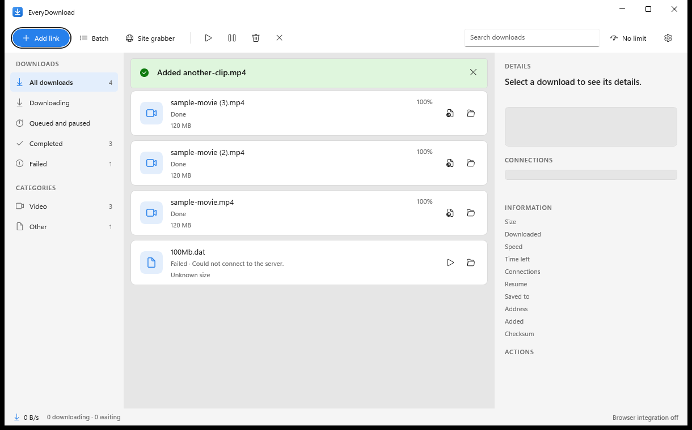

# EveryDownload

A fast download manager for Windows that combines the best of IDM, ADM, Free Download Manager, JDownloader and aria2 in one app: multi-connection downloads that get faster on their own, a browser extension with a video grabber, a scheduler, a site grabber, torrents, and virus and checksum checks.

Built with WinUI 3 (Windows App SDK) on .NET 8. It runs in the system tray.



## What makes it different

- **Smart Boost.** Most managers use a fixed number of connections. EveryDownload starts with a few, then adds two more every few seconds *only while the total speed keeps climbing*. It stops at the point where more connections stop helping, and backs off when a server answers 429 or 503. You get IDM-class speed without hammering servers that do not like it.
- **Dynamic ranges.** A file is cut into byte ranges. A connection that finishes early takes half of whichever range has the most left, so every connection stays busy to the last byte. The connection strip in the details panel shows the ranges live.
- **Mirrors.** Give a file several addresses; connections are spread across them, and an address that fails is skipped.
- **Refresh expired links.** Replace a dead link and resume. If the new file is the same size, what was already downloaded is kept.

## Features

### Downloading
- Segmented, resumable HTTP and HTTPS downloads. Falls back to one connection when the server cannot do ranges, and restarts cleanly if the file changed on the server.
- FTP and FTPS (with resume), magnet links and `.torrent` files (DHT, trackers; built on MonoTorrent).
- HLS video streams (`.m3u8`): picks the best quality, downloads the pieces side by side, decrypts AES-128, and joins them. With ffmpeg installed the result is converted to MP4.
- Login, referrer, cookies and custom headers per download; proxy support (system, none or your own).
- Automatic retries with a back-off, reconnecting when a connection drops.
- Free-space check up front; pieces stay on disk across pauses and restarts.

### Queue and control
- Pause, resume, restart, reorder by add time, simultaneous-download limit.
- **Speed limiter**: one total limit shared by every connection, plus a limit per download.
- **Scheduler**: run the queue only inside a time window on chosen days, including windows that pass midnight. A download can also start at a set time.
- Hold downloads on a **metered connection** (like ADM's Wi-Fi-only mode).
- When everything is done: nothing, sleep, hibernate, shut down, or close the app.

### Finding things to download
- **Batch download** from a pattern: `photo[001-120].jpg`, `[a-e]`, `[1-99:2]`, several ranges at once.
- **Site grabber**: lists the files on a page (and optionally the pages it links to), with filters for video, music, images, documents, archives and programs.
- **Clipboard watcher** offers links you copy.
- Drop links, magnets or `.torrent` files on the window.

### Browser extension (Chrome, Edge, Brave)
- Catches the browser's downloads and passes them, with cookies and referrer, to the app. If the app cannot be reached, the browser downloads the file itself, so nothing is lost.
- Sniffs videos and audio on the page; a **Download** button appears over videos, and the toolbar popup lists everything it found.
- Right-click: *Download with EveryDownload* and *Find files on this page*.
- Talks to the app through native messaging, so no web server is opened on your PC.

### Safety
- Checksum verification (MD5, SHA-1, SHA-256, SHA-512, recognised by length).
- Scans finished files with Microsoft Defender when it is installed.
- File names from servers can never choose a folder.

### Everything else
- Sorts files into folders by type (Video, Music, Documents, Archives, Programs, Images, Torrents).
- Live speed graph, connection strip, taskbar progress, tray icon with notifications.
- Light, dark or system theme; start with Windows, hidden in the tray.

## Requirements

- Windows 10 (build 17763) or later, 64-bit.
- To build: the .NET 8 SDK and, for the installer, [Inno Setup](https://jrsoftware.org/isinfo.php).

## Build and run

```powershell
dotnet build EveryDownload.csproj -c Release
dotnet run --project EveryDownload.csproj
```

Build the installer (publishes a self-contained build, then runs Inno Setup):

```powershell
powershell -ExecutionPolicy Bypass -File build-installer.ps1
```

## Add the browser extension

1. Start EveryDownload once and choose **Get started** (or Settings → Browser → *Set up / repair browser hand-off*). This registers the native messaging host for your browsers.
2. Open `chrome://extensions` (or `edge://extensions`), turn on **Developer mode**, choose **Load unpacked**, and pick the `extension` folder next to `EveryDownload.exe` (Settings → Browser → *Open the extension folder*).

The extension has a fixed ID (set by the key in its manifest) so the host can allow exactly that extension.

## Tests

```powershell
dotnet test tests\EveryDownload.Tests\EveryDownload.Tests.csproj
```

The tests start a local web server that can ignore ranges, drop connections and return 404s, and check the engine against it: parallel and split ranges, resume, mirrors, speed limit, HLS with encryption, the queue, checksum failure, and restart persistence.

## Limits worth knowing

- The clipboard offer only appears while the window is open (not while hidden in the tray).
- HLS: live streams and SAMPLE-AES / DRM streams are not supported. DASH (`.mpd`) is not supported.
- The extension is loaded unpacked; it is not on a web store.

## Where things are stored

`%AppData%\EveryDownload`: `settings.json`, `downloads.json` (the list and each file's saved ranges), `log.txt`.
